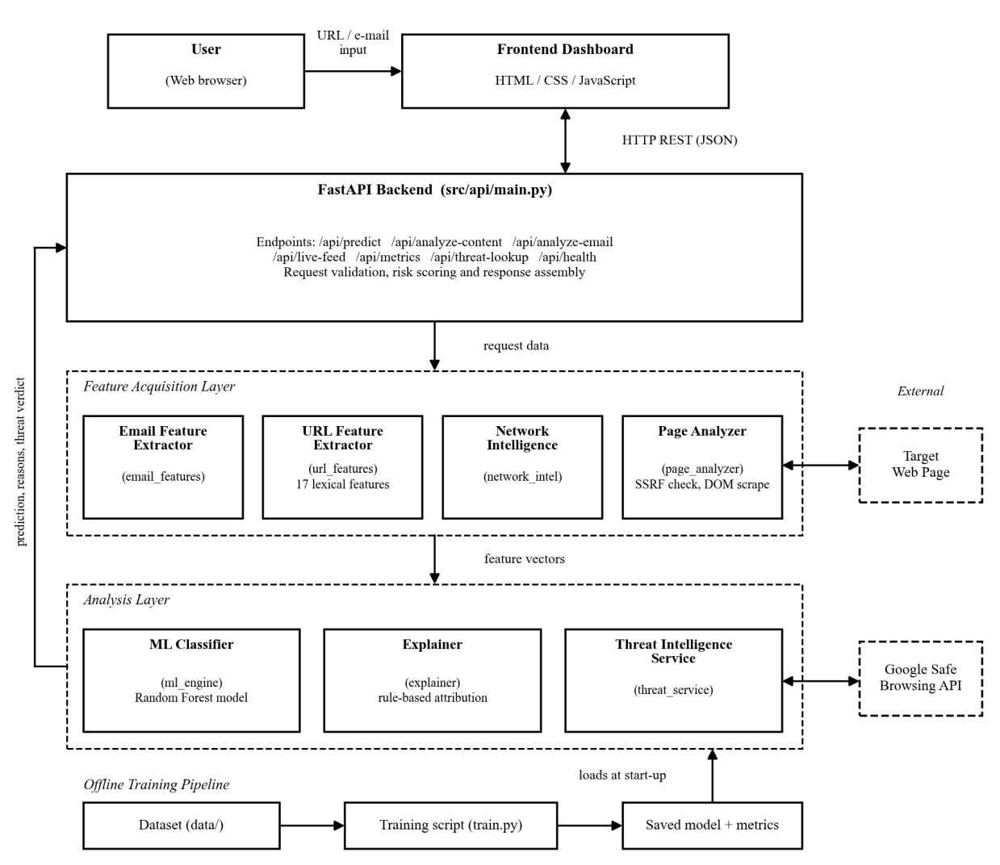
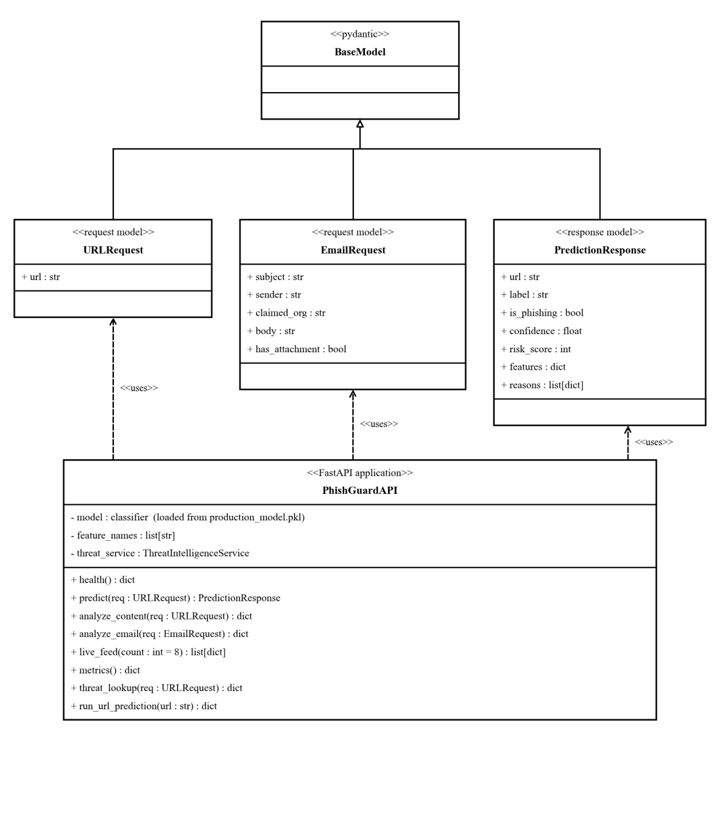
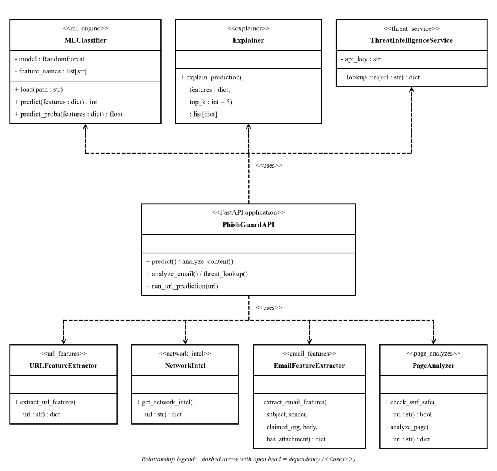
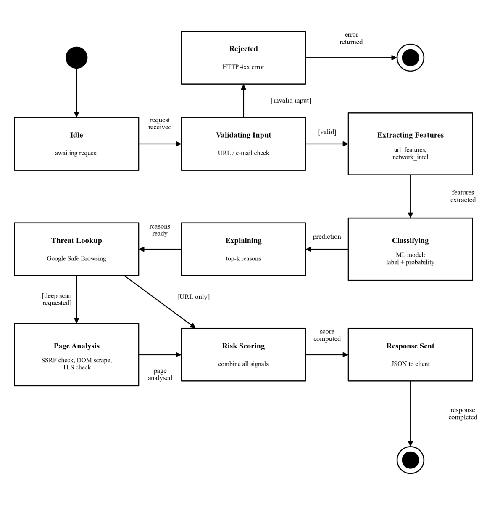
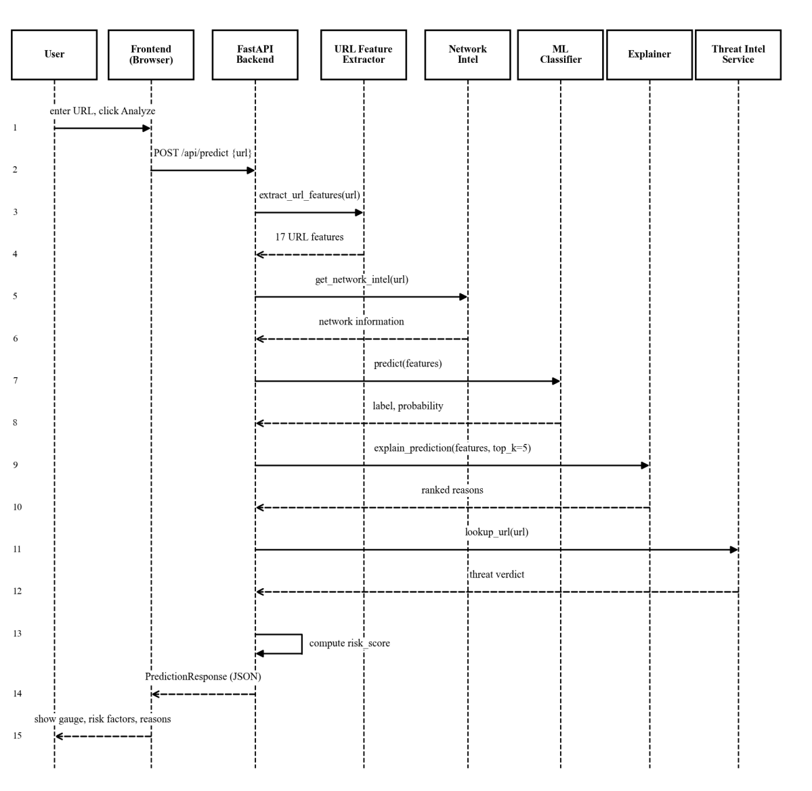
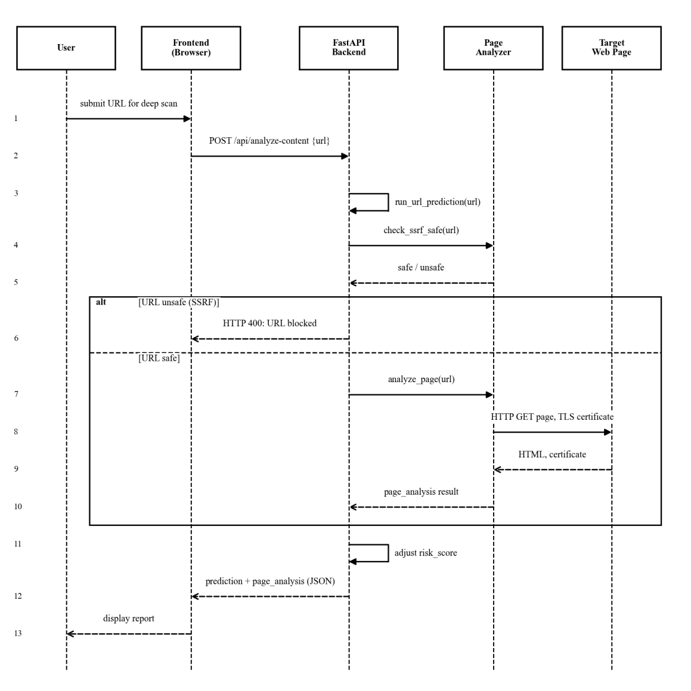

# PhishGuard Design Document
## Functional Block Diagram and UML Diagrams (Updated Final Report)

- **GitHub Repository:** [https://github.com/ShreyanBangera00/PhishGuard](https://github.com/ShreyanBangera00/PhishGuard)
- **Live Deployment:** [https://phish-guard-chi-taupe.vercel.app](https://phish-guard-chi-taupe.vercel.app)

| Name | Roll | Sap Id |
| :--- | :---: | :---: |
| Shreyan Bangera | K003 | 70102400047 |
| Yuvraj Bishnoi | K006 | 70102400067 |
| Suraj Sahoo | K001 | 70102400074 |

---

### 1. Introduction
PhishGuard is an explainable, multi-modal phishing detection platform designed to protect users against malicious URLs and deceptive social engineering emails. A user interacts with a modern corporate web dashboard to submit URLs for real-time lexical inspection or deep page scraping, or to analyze suspicious emails directly from their inbox.

The FastAPI backend processes requests through dedicated feature extraction and threat intelligence layers. For URLs, it extracts 17 structural and lexical features, queries Google Safe Browsing API, fetches live DNS/WHOIS/TLS network intelligence, and evaluates risk with an ensemble Random Forest model accompanied by transparent, rule-based feature attribution explanations. For emails, the system evaluates social engineering tactics through the Adaptive Hybrid Multi-Factor Attribution (A-HMFA) engine, verifies sender authenticity via live DNS MX records and the Disify API, audits domain age with WHOIS, and offers direct 1-click email ingestion from Gmail via an SSL IMAP integration.

This document describes the design and technical architecture of the PhishGuard platform using a functional block diagram and UML diagrams (class diagram, state transition diagram, and sequence diagrams), fully updated to reflect the production source code in the repository.

---

### 2. Functional Block Diagram
Figure 1 shows the main functional blocks of PhishGuard and the data flow between them. The user interacts exclusively with the frontend dashboard. The dashboard communicates with the FastAPI backend over REST (JSON). The backend coordinates the feature acquisition layer, queries external threat intelligence and verification services (Google Safe Browsing, Disify Free Email API, live DNS and WHOIS), executes the analysis and ML layers, and synthesizes the final explainable response.

#### Table 1: Modules and Repository Responsibilities

| Block / Module | Repository Location | Key Responsibilities |
| :--- | :--- | :--- |
| **Frontend Dashboard** | `frontend/` `(index.html, style.css, app.js)` | Interactive corporate UI; provides URL Scanner, Deep Content Scan, Email Analysis with A-HMFA visual graphs, Gmail IMAP inbox picker, and live network telemetry readouts. |
| **FastAPI Backend** | `src/api/main.py` | Exposes REST endpoints (`/api/predict`, `/api/analyze-content`, `/api/analyze-email`, `/api/gmail/messages`, `/api/live-feed`), validates schemas, coordinates service modules, and computes final hybrid risk scores. |
| **URL Feature Extractor** | `src/features/url_features.py` | Extracts 17 lexical, structural, and Shannon entropy features from raw URL strings in <2 ms. |
| **Network Intelligence** | `src/features/network_intel.py` | Gathers live host telemetry: DNS A-records, IP Geolocation / ASN (`ip-api.com`), WHOIS domain age and registrar (`python-whois`), and TLS certificate validity. |
| **Live Sender Verification** | `src/features/network_intel.py` `(verify_sender_live)` | Performs real-time sender verification: queries Disify Email API for live DNS MX mail server records and burner/disposable detection, combined with WHOIS domain age audits. |
| **Email Analysis Engine** | `src/features/email_features.py` | Implements the Adaptive Hybrid Multi-Factor Attribution (A-HMFA) model: zone-weighted logging (subject vs. body), credential theft detection, urgency scoring, cross-domain attack chain synergy ($\Psi$), and token density ML proxy ($P_{ML}$). |
| **Gmail IMAP Integration** | `src/features/gmail_imap.py` | Connects to `imap.gmail.com` over SSL using Google App Passwords; extracts clean plain-text/HTML body, parses sender display names into claimed orgs, and enables 1-click scanning. |
| **Page Analyzer (Deep Scan)** | `src/scraper/page_analyzer.py` | Enforces SSRF validation (blocking private/loopback RFC-1918 IPs), fetches target DOM, detects password entry forms, brand impersonation mismatches, and external asset ratios. |
| **Threat Intelligence Service** | `src/threat_intel/threat_service.py` | Integrates Google Safe Browsing API v4 for authoritative real-time blacklisting of URLs and extracted email links. |
| **ML Classifier Engine** | `src/models/ml_engine.py`, `src/models/saved/` | Loads production Random Forest ensemble model to output calibrated phishing probabilities from tabular URL features. |
| **Explainability Layer** | `src/explainability/explainer.py` | Computes directional rule-based feature attribution scores, generating human-readable diagnostic factor cards (Critical, Warning, Safe). |
| **Offline Training Pipeline** | `src/models/train.py`, `data/prepare_dataset.py` | Prepares balanced 7,974 sample dataset, benchmarks Logistic Regression vs. Random Forest vs. GBDT on stratified 80/20 split, and exports champion artifacts. |

---

### 3. UML Diagrams

#### 3.1 Class Diagram
The class model is divided into two logical diagrams. Figure 2 illustrates the data models and the central FastAPI application interface. Request and response schemas inherit from Pydantic's `BaseModel` to guarantee strict data validation, serialization, and OpenAPI compliance. `PhishGuardAPI` encapsulates the REST routing endpoints, request handling, and response synthesis.

Figure 3 shows the service and engine components utilized by the PhishGuard backend. Python modules containing specialized functions are represented as stereotyped service classes, emphasizing loose coupling and modular separation of concerns.

#### 3.2 State Transition Diagram
Figure 4 illustrates the finite state lifecycle of an inspection request processed by the backend. A request transitions from Idle to Validating Input. Invalid payloads immediately transition to Rejected and return an HTTP 4xx response. Valid input progresses through parallel feature extraction, classification, explanation, and threat lookup states. If deep scraping is selected, the Page Analysis state verifies SSRF constraints and inspects DOM artifacts before entering the Risk Scoring state where hybrid heuristics and ML probabilities are synthesized.

#### 3.3 Sequence Diagrams
Figure 5 details the end-to-end execution flow for standard URL analysis (`POST /api/predict`). The FastAPI backend sequentially invokes the URL feature extractor, network intelligence module, machine learning classifier, explainability engine, and threat intelligence service before calculating the risk score and returning the `PredictionResponse` to the client.

Figure 6 details the execution flow for deep content analysis (`POST /api/analyze-content`). In addition to lexical prediction, the Page Analyzer executes a strict Server-Side Request Forgery (SSRF) verification. If the URL resolves to loopback, broadcast, or private RFC-1918 networks, the request is halted with HTTP 400. Legitimate public endpoints are safely scraped to evaluate login forms, external assets, and SSL certificates.

---

### 4. Advanced Production Capabilities
Through iterative software engineering and verification phases, PhishGuard incorporates several enterprise enhancements that extend beyond standard academic prototypes:

- **Live Sender Verification (Disify API + WHOIS):** Rather than relying on static sender address checks, the system performs live DNS MX mail server verification and disposable/temp-mail provider lookups via the Disify Free Email API. In parallel, `python-whois` extracts registration dates to flag newly created attack domains (<90 days old) vs. established enterprise domains.
- **Adaptive Hybrid Multi-Factor Attribution (A-HMFA v4):** Email threat scoring implements continuous zone-weighted activation (counting subject line urgency hits at 2.0x weight vs. 1.0x in message body), evaluates cross-domain attack chain synergy ($\Psi$), and applies non-linear sigmoidal scaling to prevent premature saturation at 100.
- **Gmail IMAP Inbox Integration:** Users can directly connect their Gmail account over SSL IMAP using a 16-character Google App Password. The system fetches the latest emails from Inbox or Spam, converts complex MIME/HTML messages into clean readable text while preserving embedded links, automatically parses sender display names into claimed organizations, and runs 1-click threat audits.
- **Enterprise UI Design System:** The frontend dashboard adopts a professional corporate theme built with native HTML5, CSS3, and modern typography (Calibri/Arial, eliminating AI-like monospace fonts for numbers). It features interactive SVG risk score gauges, horizontal category progress bars, and transparent risk explanations.
- **Automated Test Suite:** The platform is continuously verified by 24 comprehensive pytest automated unit and integration tests covering the FastAPI endpoints, ML inference, SSRF security guards, TLS certificate extraction, Shannon entropy computation, and A-HMFA email scoring.
